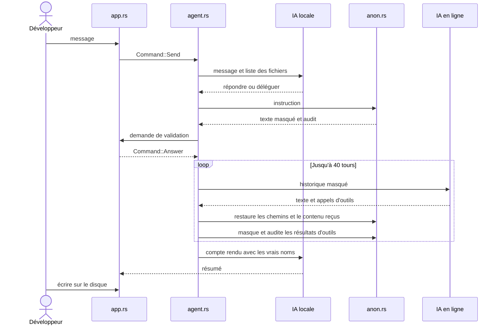

# Anonimator

Application desktop en Rust pour faire du vibe coding sans montrer votre vrai code à une IA en ligne.

Vous parlez à une IA locale. Elle transmet les instructions à une IA en ligne, qui travaille sur une version pseudonymisée du projet. Ses modifications reviennent avec les vrais noms et attendent votre validation.

```
Vous ⇄ IA locale (Ollama) ⇄ Anonymiseur + coffre ⇄ IA en ligne (Claude ou compatible OpenAI)
                                    ⇅
                             Votre projet (après validation)
```

## Installation

1. Installez [Rust](https://rustup.rs) et [Ollama](https://ollama.com).
2. Téléchargez un modèle local, puis lancez Ollama :
   ```
   ollama pull llama3.2
   ollama serve
   ```
3. Lancez l'application :
   ```
   cargo run --release
   ```
4. Connectez une IA en ligne, puis ouvrez un dossier de projet.

## Connexion à l'IA en ligne

| Bouton | Ce qui se passe | Facturation |
|---|---|---|
| **Continue with ChatGPT** | Connexion dans le navigateur, sans clé d'API | Votre forfait ChatGPT |
| **Se connecter à Claude** | Ouvre la page des clés, puis vous collez la clé dans l'application | Crédits de l'API Anthropic, à l'usage |

Claude ne propose pas de connexion équivalente : Anthropic interdit d'utiliser un abonnement Free, Pro ou Max dans une application tierce. Il faut donc une clé d'API, facturée séparément de l'abonnement.

La connexion ChatGPT suit le parcours officiel d'OpenAI, en préversion, pour les projets open source et les projets personnels locaux. Une application payante ou hébergée doit d'abord remplir le formulaire d'OpenAI. Le compte doit être éligible à l'usage du forfait.

Le jeton de renouvellement ChatGPT et les clés d'API sont conservés dans le gestionnaire d'identifiants de Windows. Les clés d'API peuvent aussi venir de `ANTHROPIC_API_KEY` ou `OPENAI_API_KEY`. Le mode « Compatible OpenAI » (Mistral, OpenRouter…) se trouve dans les réglages avancés.

## Ce qui est masqué

Rien à configurer : le mode auto, activé par défaut, analyse le code à l'ouverture du projet et avant chaque message.

| Élément | Traitement |
|---|---|
| Identifiants déclarés dans le projet (fonctions, types, champs, variables, paramètres) | Pseudonyme stable, par exemple `zq_k3f9q2` |
| Mode auto : clés d'objets et propriétés lues sur des données, même non déclarées | Pseudonyme stable |
| Valeur d'un nom sensible (`password`, `pwd`, `token`, `api_key`, `secret`, `pin`, `cookie`…), quelle que soit sa forme | Toujours masquée, même `"123456"` ou un nombre |
| Clés ressemblant à une valeur générée (longues, mêlant lettres et chiffres, peu répétitives) | Toujours masquées |
| Valeurs sans guillemets des fichiers YAML et TOML | Toujours masquées, sauf `true`, `false` et les mots génériques |
| Commentaires | Remplacés entièrement par un pseudonyme |
| Chaînes de caractères | Remplacées si elles contiennent du texte ou au moins 4 chiffres, sauf paquets publics importés et numéros de version |
| Dossiers et fichiers | Pseudonymisés, l'extension reste visible |
| E-mails, téléphones, IBAN, cartes, URL, IP, clés d'API, jetons, clés privées, chemins personnels | Pseudonyme `zp_…` |
| Nom du dossier, du paquet et de l'utilisateur Windows | Masqués partout, même au milieu d'un mot, sans tenir compte de la casse |

Les secrets détectés sont listés dans l'onglet Coffre, avec leur fichier et leur ligne, sans leur valeur. Les réglages avancés permettent d'ajouter des termes si besoin.

Les noms venant des bibliothèques importées (`HashMap`, `println`, `useState`…) et les appels de méthodes restent lisibles : sans eux, l'IA en ligne ne pourrait pas écrire de code utile. Le mode auto peut tout de même masquer un champ de bibliothèque peu courant, ce qui gêne un peu l'IA en ligne mais n'abîme jamais le code restitué. Vous pouvez le désactiver si elle reconnaît mal une bibliothèque.

## Protections

- **Audit avant chaque envoi** : si un nom connu, un terme interdit ou un secret subsiste, l'envoi est bloqué.
- **Restitution vérifiée** : un fichier qui ne redevient pas identique après anonymisation puis restauration n'est pas envoyé.
- **Validation** : par défaut, vous voyez et approuvez chaque envoi, et rien n'est écrit sur le disque sans votre accord.
- **Fichiers jamais partagés** : `.env`, clés, certificats, `credentials*`, `*secret*`, `.git`, et tout ce qu'exclut `.gitignore`. Les fichiers cachés sont aussi exclus.
- **Texte libre non partagé par défaut** : Markdown, HTML, Vue, Svelte, texte et extensions inconnues.
- **IA en ligne confinée** : elle peut lister, lire, chercher et proposer des modifications dans le projet. Elle n'a aucun accès au shell.
- **IA locale vraiment locale** : une adresse Ollama hors de `localhost` est refusée. Si Ollama ne répond pas, rien n'est envoyé.

## Limites

L'anonymat n'est pas absolu :

- **Votre compte reste identifiable** : le fournisseur voit votre compte ou votre clé d'API, votre facturation et votre adresse IP. C'est encore plus direct avec la connexion ChatGPT, liée à votre compte personnel. L'outil masque le contenu, pas le fait que c'est vous. Pour limiter cela, il faut un compte dédié et un VPN ou Tor.
- **Paquets privés** : un nom importé d'un paquet externe est considéré comme public. Si ce paquet est privé et hors du dossier ouvert (`use acme_interne::Secret`), ajoutez `acme_interne` aux termes à masquer.
- **Détection heuristique** : le repérage ne repose pas sur un vrai analyseur de chaque langage. Les noms de méthodes appelées mais non déclarées, les clés des fichiers TOML et YAML, et certains paramètres de closures Rust restent lisibles. Un secret passé directement à une fonction, sans nom sensible et avec moins de 3 lettres et 4 chiffres, peut aussi passer. Regardez l'onglet Échanges sur un code sensible.
- **Structure du code** : la logique, les algorithmes et les constantes numériques, comme un taux de marge, restent visibles sauf si leur nom est sensible. Une structure très reconnaissable peut identifier un projet.
- **Instruction reformulée** : l'IA locale peut laisser passer un contexte métier en mots courants. Les filtres ne détectent que les termes connus. Relisez l'instruction dans la fenêtre de validation.
- **Coffre en clair** : les correspondances sont stockées sans chiffrement dans `%APPDATA%\Anonimator\vaults`, sur votre machine.
- **Pas d'exécution** : l'IA en ligne ne peut ni compiler ni lancer les tests. C'est à vous de le faire après validation.

## Comment fonctionne le code

### Vue d'ensemble

Le projet est une bibliothèque (`src/lib.rs`) et un petit exécutable (`src/main.rs`, `src/app.rs`) qui l'affiche. L'interface ne fait aucun travail : elle envoie des `Command` à un thread unique (`agent.rs`) et affiche les `Event` qu'il renvoie. La logique se teste donc sans interface.

| Module | Rôle |
|---|---|
| `app.rs` | Interface egui : colonnes de discussion, réglages, validation, diffs |
| `agent.rs` | Orchestration d'une tâche et outils exposés à l'IA en ligne |
| `local.rs` | Client Ollama : décide quoi faire d'un message, résume le résultat |
| `remote.rs` | Clients Anthropic, forfait ChatGPT et compatible OpenAI |
| `chatgpt.rs` | Connexion « Sign in with ChatGPT », vérification d'identité, jetons |
| `anon.rs` | Anonymisation du code et du texte, restauration, audit de sortie |
| `lexer.rs` | Découpage du code en tokens, pour tous les langages |
| `scan.rs` | Repérage des noms à masquer et des imports publics |
| `keep.rs` | Vocabulaire générique, jamais masqué |
| `vault.rs` | Correspondances entre pseudonymes et valeurs réelles |
| `workspace.rs` | Fichiers partageables, confinement des chemins, modifications en attente |
| `config.rs` | Réglages, clés d'API, contrôle des adresses |

### Parcours d'un message



L'IA locale voit le vrai message et les vrais noms de fichiers, mais elle tourne sur cette machine : une adresse hors de `localhost` est refusée. Si elle est injoignable ou répond un JSON invalide, la tâche s'arrête sans rien envoyer (`local.rs`, `parse_plan`).

### Anonymisation

**1. Préparer le vocabulaire** (`Workspace::prepare`), à l'ouverture du projet et avant chaque message :

- `scan.rs` relève les noms déclarés dans chaque fichier. En mode auto, il ajoute les clés d'objets et les propriétés lues sur des données.
- Les noms de fichiers et de dossiers rejoignent le vocabulaire.
- Le nom du dossier, du paquet et de l'utilisateur Windows deviennent des termes interdits, cherchés même à l'intérieur des mots.
- `collect_public_imports` retire enfin les noms importés de paquets externes, pour que `Duration` ou `useState` restent lisibles.

**2. Masquer un fichier** (`Anonymizer::code`) : `lexer.rs` découpe la source, et la concaténation des tokens redonne toujours l'original. Chaque token est ensuite traité selon son type :

| Token | Traitement |
|---|---|
| Identifiant | Masqué s'il figure au vocabulaire, contient un terme interdit ou ressemble à une clé générée |
| Chaîne | Masquée, sauf format sans contenu, version ou paquet public importé |
| Commentaire | Masqué entièrement |
| Nombre | Masqué seulement s'il suit un nom sensible, comme `pin = 4821` |

`forced_tokens` repère les valeurs qui suivent un nom sensible. Une dernière passe (`scrub_pii`) applique les motifs de secrets et de données personnelles.

**3. Vérifier avant l'envoi** : deux barrières indépendantes bloquent l'envoi en cas de doute.

- `code` refuse un fichier si restaurer sa version masquée ne redonne pas exactement l'original.
- `audit` cherche dans le texte final tout nom connu, terme interdit ou secret restant.

**4. Restaurer au retour** (`Vault::restore`) : une seule passe remplace chaque pseudonyme connu. Elle fonctionne aussi à l'intérieur d'un nouveau nom, comme `get_zq_abc123`, et ignore ce qu'elle ne connaît pas.

Les pseudonymes sont aléatoires et ne dérivent pas des valeurs :

| Forme | Contenu |
|---|---|
| `zq_a1b2c3`, `Zqa1b2c3`, `ZQ_A1B2C3` | Identifiant, selon sa casse d'origine |
| `zs_a1b2c3` | Chaîne |
| `zc_a1b2c3` | Commentaire |
| `zp_a1b2c3` | Secret ou donnée personnelle |

### Outils de l'IA en ligne

L'IA en ligne ne touche jamais au disque. Elle dispose de cinq outils, définis dans `remote.rs` et exécutés par `run_tool` dans `agent.rs` :

| Outil | Effet |
|---|---|
| `list_files` | Liste les chemins masqués des fichiers partageables |
| `read_file` | Renvoie un fichier masqué |
| `search` | Cherche un texte dans les versions masquées |
| `write_file` | Prépare l'écriture d'un fichier, après restauration |
| `edit_file` | Remplace un passage dans la version masquée, puis restaure le résultat |

Les écritures restent dans `Workspace::pending`, en mémoire, jusqu'à la validation du diff. `Workspace::resolve` refuse les chemins absolus, les `..` et les liens qui sortent du projet. Les messages d'erreur passent aussi par l'anonymiseur, car ils peuvent citer un vrai chemin.

### Clients en ligne

`RemoteAi` garde un historique qui ne fait que s'allonger, et chaque fournisseur a sa méthode `step_*` :

| Fournisseur | Format | Particularité |
|---|---|---|
| Anthropic | `POST /v1/messages` | Les réponses sont rejouées telles quelles, blocs de réflexion compris |
| Forfait ChatGPT | `POST /v1/responses`, en flux SSE | `store` à `false` : tout l'historique est renvoyé à chaque tour |
| Compatible OpenAI | `POST /chat/completions` | Pour Mistral, OpenRouter et les autres services compatibles |

`chatgpt.rs` suit le parcours officiel d'OpenAI : écoute locale sur `127.0.0.1`, PKCE, vérification de la signature du jeton d'identité, puis rotation du jeton de renouvellement.

### Données stockées

| Emplacement | Contenu |
|---|---|
| `%APPDATA%\Anonimator\config.json` | Réglages, sans clé ni jeton |
| `%APPDATA%\Anonimator\chatgpt.json` | Compte, identifiants d'application, sans jeton |
| `%APPDATA%\Anonimator\vaults\<hash>.json` | Coffre de chaque projet, en clair |
| Gestionnaire d'identifiants de Windows | Clés d'API et jeton de renouvellement ChatGPT |

## Développement

```
cargo test
cargo clippy --all-targets
```

| Tests | Ce qu'ils vérifient |
|---|---|
| `tests/end_to_end.rs` | Faux serveurs Ollama et Anthropic : inspecte les octets reçus par le serveur « en ligne », puis le fichier écrit |
| `tests/chatgpt.rs` | Faux serveurs OpenAI : connexion, identité falsifiée, renouvellement, flux SSE |
| `tests/dogfood.rs` | L'anonymiseur appliqué au code de ce dépôt |
| Tests unitaires dans `src/` | Lexer, repérage des noms, secrets, coffre, chemins |

Aucun test n'appelle de vrai service ni le gestionnaire d'identifiants.

### Ajouter un langage

1. Ajoutez son extension dans `lang_for_extension` (`lexer.rs`), avec ses commentaires et ses guillemets.
2. Ajoutez ses mots-clés de déclaration en tête de `scan.rs`, s'ils manquent.
3. Ajoutez un test dans `scan.rs`, sur le modèle de `go_declarations`.

Une extension inconnue est traitée comme du texte libre : elle n'est pas partagée par défaut.

### Ajouter un fournisseur en ligne

1. Ajoutez une variante à `Provider` (`config.rs`).
2. Ajoutez sa méthode `step_*` et son format de résultats d'outils dans `remote.rs`. Elle ne reçoit que du contenu déjà masqué.
3. Proposez-le dans `advanced_settings` (`app.rs`).
